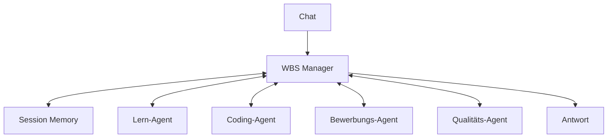

# WBS Agent – Multi-Agent Engineering

## Moin zusammen!

Im Rahmen meiner Umschulung zum Softwareentwickler hatten wir die Aufgabe, einen eigenen KI-Agenten zu entwickeln. Ich habe das Ganze direkt praktisch umgesetzt und meinen bestehenden WBS-Agenten mit den Inhalten aus neun Unterrichtslektionen erweitert.

Dabei ging es nicht nur darum, verschiedene KI-Agenten miteinander zu verbinden, sondern auch darum, wie sie selbstständig arbeiten, Informationen speichern, Entscheidungen treffen und mit Fehlern umgehen.

Unter der Haube stecken **TypeScript, Node.js, n8n, das OpenAI Agents SDK und Anthropic Claude**. Dazu kommen parallele und sequenzielle Verarbeitung, Handoffs, Werkzeuge, Gedächtnis, Guardrails und menschliche Freigaben.

So einen Agenten zum Laufen zu bekommen ist das eine. Ihn zuverlässig, sicher und vernünftig arbeiten zu lassen, ist dann noch mal eine ganz andere Baustelle. Ich habe die einzelnen Funktionen mit KI-Unterstützung umgesetzt, getestet, Fehler behoben und die Ergebnisse Schritt für Schritt verbessert.

Die Erkenntnisse aus diesem Schulprojekt möchte ich auch für meine anderen KI-Projekte nutzen. Schaut euch gerne um. Für Tipps, Ideen und Verbesserungsvorschläge bin ich immer offen.

**In diesem Sinne: Weiterbauen, ausprobieren und dazulernen!** 🚀

## Architektur



Das n8n-Beispiel demonstriert das Manager-Muster. Das TypeScript-Labor implementiert zusätzlich sequenzielle und parallele Verarbeitung, Handoffs, eigene Agentenschleifen, persistente Lernnotizen und überprüfbare Freigaben. Die Module sind Lernbeispiele, keine produktionsreife SaaS-Anwendung.

## Schnellstart

Voraussetzungen: Node.js 22+, npm, Bash und Python 3. Für die Offline-Prüfung ist kein KI-Schlüssel erforderlich.

```bash
bash wbs-abschluss-test.sh
```

Das Skript installiert fehlende Abhängigkeiten, prüft beide TypeScript-Projekte, führt 28 lokale Tests aus und zeigt die Logistik-Simulation. Die Workflow-Struktur wird separat geprüft:

```bash
python3 scripts/check_workflows.py
```

### Optionale Live-Beispiele

Eine eigene, autorisierte Anthropic-API-Zugangsberechtigung ist erforderlich. Die Aufrufe können Kosten verursachen. `lektion-06/.env.example` dokumentiert die Konfiguration. Setze `ANTHROPIC_API_KEY` und bei Bedarf `LLM_MODEL` lokal; verwende ein für dein Konto freigegebenes Modell.

```bash
bash wbs-livetest.sh --live
```

Die Ausgaben sind fachlich zu prüfen; ein erfolgreicher Prozess allein belegt keine korrekte Modellantwort. Keine echten Nachrichten oder Beschwerden werden versandt.

## Projektstruktur

```text
.
├── .github/workflows/        # Offline-CI
├── docs/                     # Architektur, Teststand, Sicherheitsgrenzen
├── workflows/                # Bereinigte n8n-Importvorlagen
├── lektion-05/               # OpenAI-kompatible API-Anbindung
├── lektion-06/               # Agents SDK, Express und Lektionen 07–09
│   └── src/
│       ├── agents/           # Support-Agent
│       ├── samples/          # Tools, Zod, Guardrails
│       ├── lektion-07/       # Orchestrierung
│       ├── lektion-08/       # Agentenkreislauf
│       ├── lektion-09/       # Speicher und Freigaben
│       └── abschluss/        # Integrationstest
├── scripts/                  # Workflow-Strukturprüfung
├── wbs-abschluss-test.sh
└── wbs-livetest.sh
```

## n8n importieren

Die beiden JSON-Dateien in `workflows/` sind inaktive, bereinigte Vorlagen. Importiere sie in eine eigene n8n-Testinstanz und ordne jedem Claude-Modell deine eigenen Credentials zu. Der Modellname muss für dein Konto verfügbar sein. Vorlagen erst im Editor testen; keinen öffentlichen Chat freischalten. Die Manager-Vorlage enthält keine Live-MCP-Verbindung und keinen Morgenbot. Der Onboarding-Workflow nutzt ausschließlich fiktive Daten und eine Nachrichtenvorschau.

## Qualität und Grenzen

Siehe [Architektur und Teststand](docs/architecture.md) sowie [Sicherheitskonzept](docs/security.md). Der private Originalstand wurde mit 24 lokalen Tests, 11 Live-Beispielen und zwei gezielten Live-Nachtests geprüft; das Qualitätsupdate erweitert die lokale Suite um vier Tests. Die bereinigten n8n-Vorlagen benötigen nach dem Import einen neuen Funktionstest. Die CI prüft ausschließlich offline.

Dieses Repository enthält weder private Serverexporte noch Schulzugangsdaten oder originalen Unterrichtstext. Die Rechte an einer öffentlichen Weiterverwendung der Projektdateien müssen vor Veröffentlichung geklärt werden; eine Open-Source-Lizenz wird nicht ungefragt vergeben.
